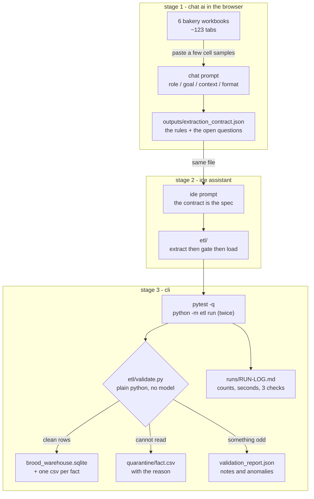

# workflow diagram

## mermaid



## ascii, same pipeline

```
+--------------------- stage 1 : chat -------------------------+
|  6 workbooks --(paste cell samples)--> chat ai               |
|  ~123 day tabs, summary tabs, 2 pos week grids              |
|  knobs it must not guess: blanks, units, spellings, merges  |
+-------------------------------------------------------------+
                            |
                            v  outputs/extraction_contract.json
+--------------------- stage 2 : ide --------------------------+
|  contract --> assistant: restate the rules, flag what is    |
|  unclear, then write the modules                            |
|  etl/contract.py  etl/normalize.py  etl/extract.py         |
|  etl/validate.py  etl/load.py      etl/__main__.py         |
+-------------------------------------------------------------+
                            |
                            v  code as the artifact
+--------------------- stage 3 : cli --------------------------+
|  pytest -q --> python -m etl run --> run again (same        |
|  counts) --> read validation_report.json                    |
|                                                              |
|    +------ the gate, plain python, no ai in it ------------+ |
|    | row is fine     -> warehouse                          | |
|    | row is not fine -> quarantine/fact.csv + reason        | |
|    | something odd   -> notes in the report                | |
|    +-------------------------------------------------------+ |
|  then 3 checks written from scratch, no etl imports        |
+-------------------------------------------------------------+
```

## the chain in three lines

1. **chat to ide.** the contract is literally the file the code reads:
   `python -m etl run --contract outputs/extraction_contract.json`.
2. **ide to cli.** the `etl/` package is what the terminal runs and what pytest
   tests.
3. **cli back to chat.** the quarantine rows and the anomaly notes are what a
   later chat session would use to fix the contract. the loop closes, so the
   next month is cheaper than this month was.
